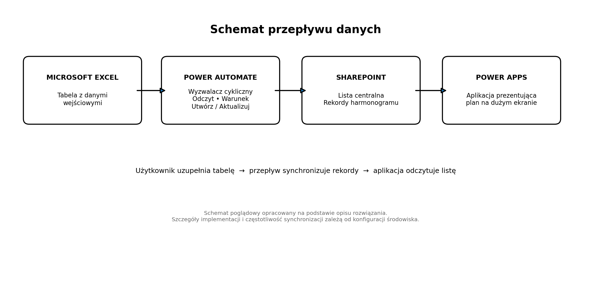

# Medical Surgery Schedule Automation

Demonstracyjna dokumentacja rozwiązania synchronizującego harmonogram z tabeli Excel do listy SharePoint i prezentującego go w aplikacji Power Apps.

## Cel

Użytkownik wprowadza lub aktualizuje wpisy w tabeli Excel. Cykliczny przepływ Power Automate odczytuje tabelę, wyszukuje odpowiadający rekord SharePoint po identyfikatorze i tworzy nowy element albo aktualizuje istniejący. Power Apps odczytuje listę SharePoint i wyświetla plan na dużym ekranie.

## Architektura



1. **Excel** – tabela z danymi harmonogramu.
2. **Power Automate** – cykliczny przepływ synchronizacji; na udokumentowanej konfiguracji uruchamia się co minutę.
3. **SharePoint** – lista przechowująca zsynchronizowane rekordy.
4. **Power Apps** – aplikacja do prezentowania planu.

## Technologie

- Microsoft Excel
- Microsoft Power Automate
- Microsoft SharePoint
- Microsoft Power Apps

## Struktura repozytorium

```text
medical-surgery-schedule-automation/
├── README.md
├── architecture.png
├── workflow.md
├── power-apps.md
└── screenshots/
    └── README.md
```

## Dokumentacja

- [Logika przepływu Power Automate](workflow.md)
- [Aplikacja Power Apps](power-apps.md)
- [Zrzuty ekranu demonstracyjne](screenshots/)

## Model danych

Widoczna tabela Excel zawiera m.in. pola: `ID_Wpisu`, `Termin`, `Sala`, `Zabieg`, `Pacjent`, `Operator`, `Typ`, `Uwagi`, `Status`. Wartości i dane osobowe w publicznym demo muszą być fikcyjne.

## Autor

Wojciech Jakubowski

## Ważna informacja

Dokumentacja została przygotowana na podstawie opisu projektu i zrzutów konfiguracji. Nie zawiera eksportu przepływu ani formuł źródłowej aplikacji. Nie publikuj rzeczywistych danych medycznych, danych pracowników, prywatnych adresów SharePoint ani identyfikatorów środowiska. Przed publicznym opisaniem wdrożenia uzyskaj zgodę organizacji.
